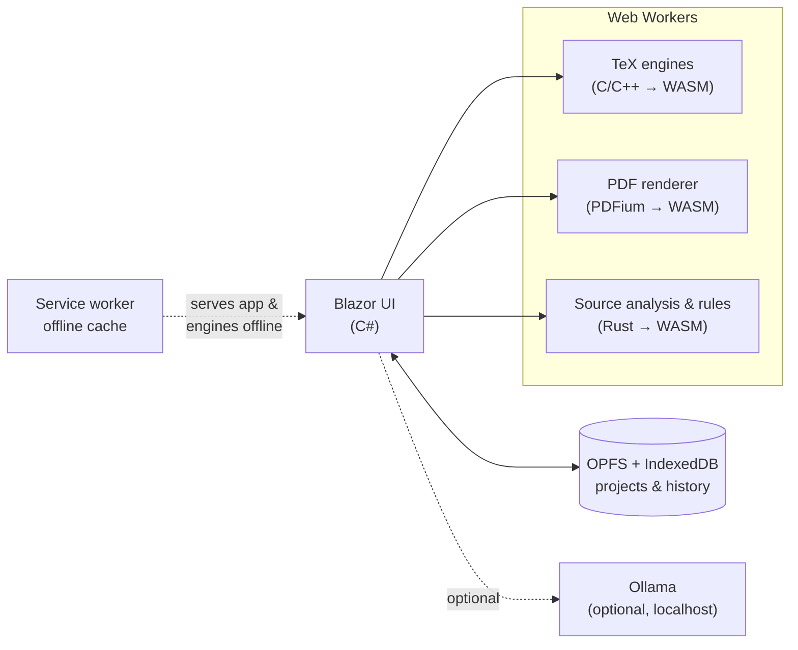
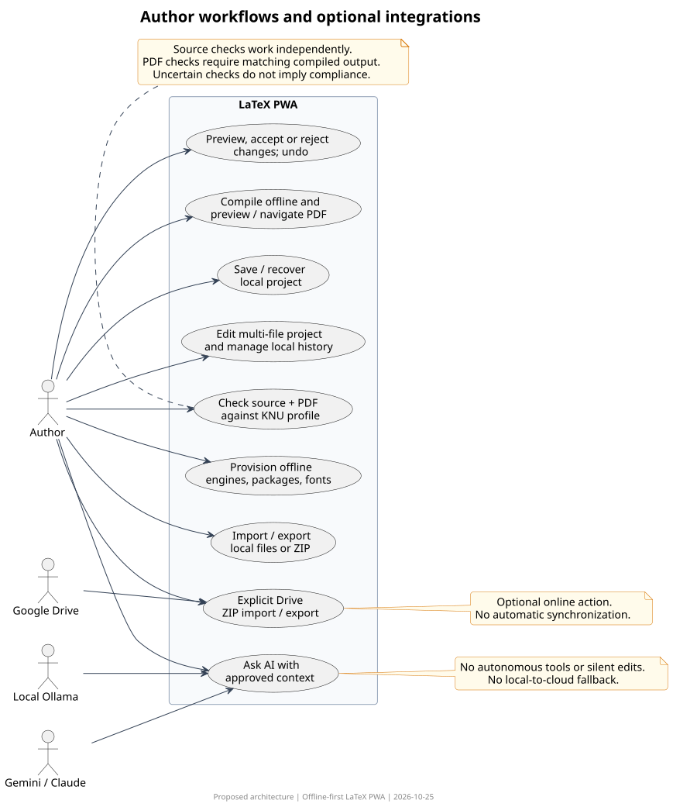
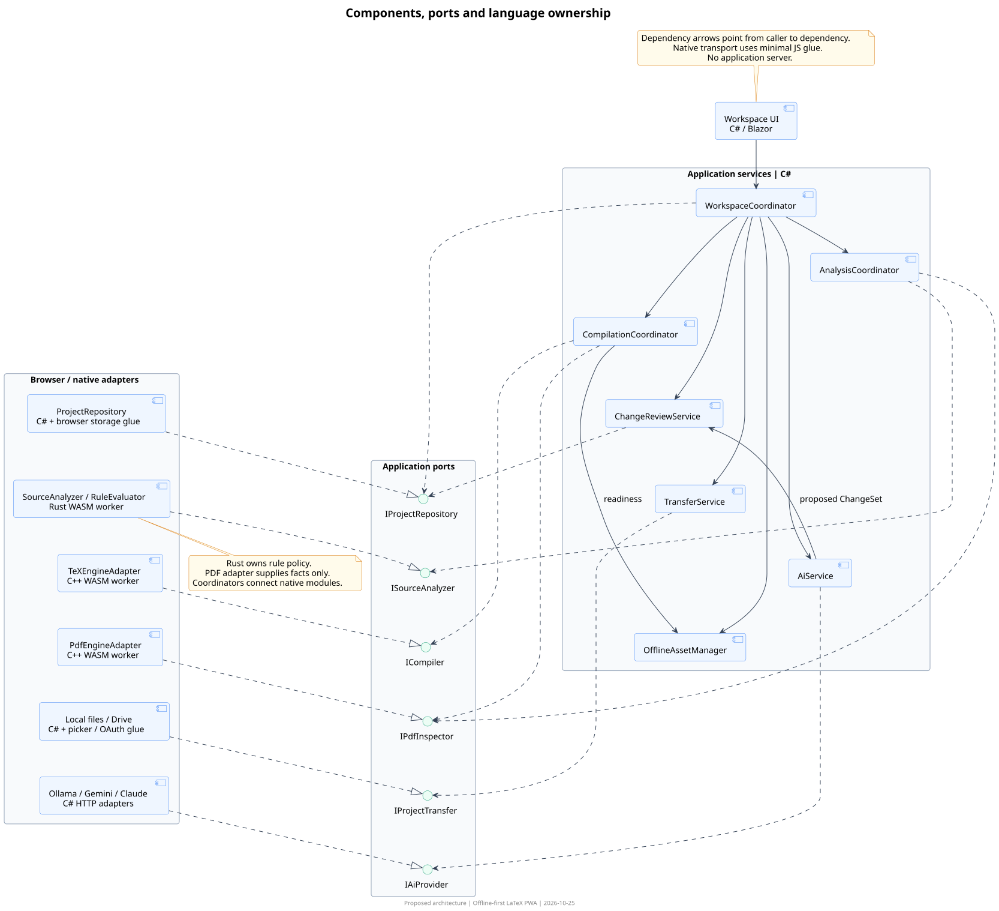
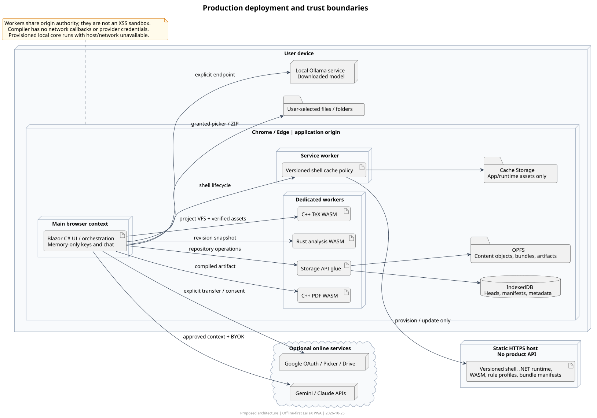
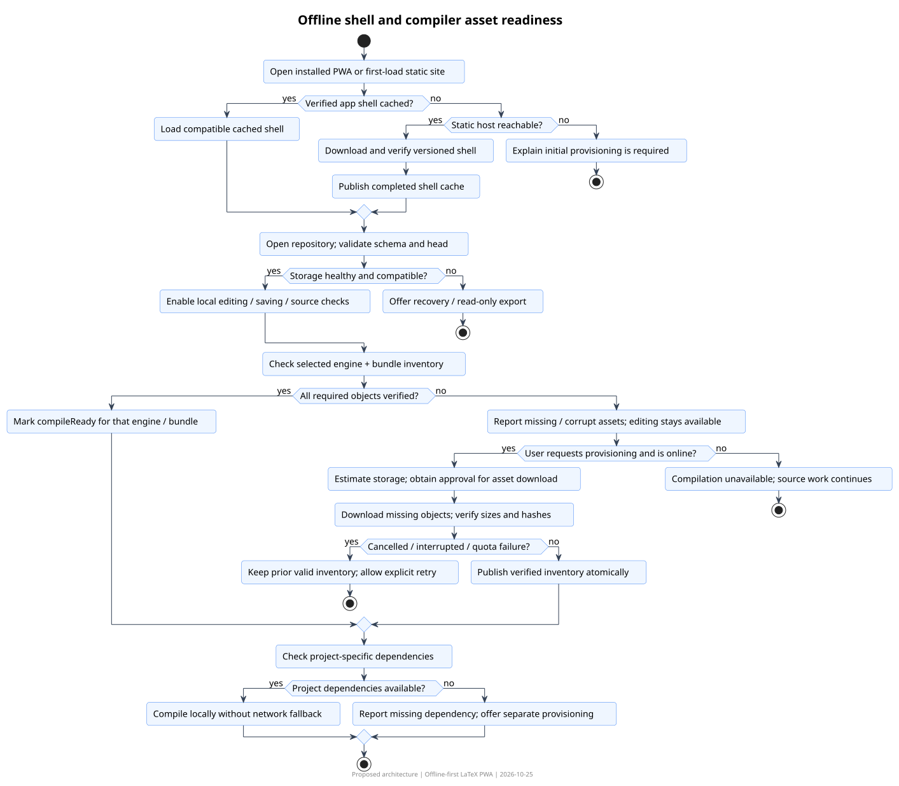

<div align="center">

# Overclone

**An offline-first LaTeX editor that runs entirely in your browser.**

Write, compile and preview LaTeX projects with no server, no installation and no internet after the first visit.
Built-in checks review theses against the KNU FCSC 2025 formatting guidelines.


[Architecture](docs/architecture.md) ·
[Getting started](#getting-started)

</div>

---

## Why Overclone

Online LaTeX editors need a connection and keep your work on someone else's server.
Overclone takes the same workflow — multi-file projects, compilation, PDF preview — and
moves all of it into the browser:

- 🔌 **Works offline.** After the first visit the app, all four TeX engines and the PDF renderer are cached. Close the browser, disconnect, come back — it still compiles.
- 🔒 **Your files stay on your device.** Projects live in the browser's private storage (OPFS + IndexedDB). There is no backend and no account.
- 🎓 **Checks for theses.** Source and PDF checks based on the KNU FCSC 2025 guidelines, with fixes you preview and approve.

## Features

| | |
|---|---|
| 📝 **Editor** | Multi-file projects, syntax highlighting, find & replace, command suggestions, undo/redo, autosave |
| ⚙️ **Compilation** | pdfLaTeX, LaTeX/DVI, XeLaTeX and LuaLaTeX with BibTeX and Biber, compiled to WebAssembly and run in Web Workers |
| 📄 **PDF preview** | Continuous reader, search, download, source ↔ PDF navigation (SyncTeX) |
| ✅ **Checks** | Engine diagnostics, cross-reference checks and the KNU FCSC ruleset, shown inline in the editor |
| 🔁 **Reviewed changes** | Every automatic fix is shown as a diff and applied only after explicit approval, with one-click undo |
| 🕓 **History** | Local revision history: browse, compare and restore earlier versions |
| 📦 **Import / export** | Single files, whole folders and ZIP archives, including binary assets |
| 🤖 **Local AI (optional)** | Chat and inline review through a locally installed [Ollama](https://ollama.com) model; nothing leaves your machine |

## How it works



The C# application coordinates everything; heavy work runs in separate WebAssembly
workers so the editor never freezes. The service worker installs the whole release —
UI, engines and renderer — as one integrity-checked snapshot, so an incomplete update
never replaces a working version.

<details>
<summary><b>UML diagrams</b></summary>

| Use cases | Components |
|---|---|
|  |  |
| **Deployment** | **Offline readiness** |
|  |  |

All diagrams and their PlantUML sources are in [`docs/uml`](docs/uml).

</details>

## Tech stack

| Layer | Technology |
|---|---|
| UI and application logic | C#, .NET 10, Blazor WebAssembly |
| Source analysis and rules | Rust 1.91 → WASM (`wasm-bindgen`) |
| TeX engines and PDF rendering | C/C++ → WASM (Emscripten 6.0.13), PDFium |
| Storage | Origin Private File System, IndexedDB |
| Offline | Service worker with SRI-verified release cache |
| Tests | xUnit, Playwright browser suites |
| Tooling | Docker Compose — no SDKs needed on the host |
| Hosting | Amazon S3 + CloudFront, built by AWS CodeBuild |

## Getting started

The only requirement is **Docker with the Compose plugin**. .NET, Emscripten, Rust and Node all run in containers.

```sh
git clone <repository-url> overclone
cd overclone
./dev.sh up -d --build
./dev.sh logs -f app native rust     # wait for "Now listening"
```

Open **http://localhost:8081**. The first start downloads the toolchain images and builds the C++ and Rust modules, so it takes a few minutes.

### Run the tests

```sh
./dev.sh --profile test build app rust js-test   # once
./verify.sh quick                                # .NET tests + JS contracts
./verify.sh native                               # C++ modules
./verify.sh rust                                 # Rust analyzer
```

### Build a release

The compiler suite and PDF renderer (`compiler-suite.zip`, `e1.js`, `e1.wasm`) are
large binaries kept outside Git. Their exact sizes and SHA-256 hashes are pinned in
[`bundled-runtime.json`](src/Client/Compilation/Provisioning/bundled-runtime.json),
and the build refuses any other files.

```sh
python3 scripts/stage-bundled-runtime.py \
  --compiler-zip path/to/compiler-suite.zip --renderer path/to/renderer-dir
./dev.sh --profile test run --rm --no-deps -T publish-rust
./dev.sh --profile test run --rm --no-deps -T publish-client
```

The result is a static site that can be hosted anywhere that serves files over HTTPS.

## Project structure

```
src/Client/          Blazor app: UI, workspace, compilation, checks, review, AI
src/Server/          Development host that serves the Blazor app locally
rust/                Source analysis and KNU rules (compiled to WASM)
native/              C++ modules and the PDF renderer interface
scripts/             Build, staging and browser test scripts
tests/               .NET tests, fixtures and browser harnesses
docker/              Toolchain images
docs/                Architecture and UML diagrams
compose.yaml         All development, test and publish services
```

## Browser support

Desktop **Chrome** and **Edge**. The app relies on the Origin Private File System,
module workers and a large offline cache. Mobile browsers limit storage and memory too
much for a full TeX distribution.

## Authors

| | Main areas |
|---|---|
| **Artem Lutai** | Architecture and UML, TeX engines and the compiler suite (C/C++ → WASM), PDF renderer and reader, compilation pipeline, Rust source analysis, local AI (Ollama) |
| **Roman Sukhaniuk** | Workspace and local storage (OPFS, IndexedDB, history), editor and UI, Rust source analysis and KNU checks, deployment (AWS S3, CloudFront, CodeBuild) |
