# Application architecture

Status: proposed implementation blueprint, 2026-10-25. The repository currently
demonstrates Blazor calling independent C++ and Rust word-count workers. None of
the editor, persistence, compiler, analyzer or AI capabilities below is implemented
by this documentation. See [decisions](decisions.md) for accepted constraints and
unproven dependencies, [contracts](contracts.md) for boundary semantics and
[roadmap](roadmap.md) for implementation acceptance criteria.

## Product boundary

Deliver a desktop Chrome/Edge PWA with complete local Overleaf-style authoring:
multi-file projects, editing, bibliography and references, compilation, PDF preview,
source/PDF navigation, diagnostics, local history and reviewed changes. Add
versioned diploma checks over both source and PDF. Collaboration, application
accounts, automatic Drive sync, a custom backend and a companion application are
excluded. Drive import/export and Gemini/Claude BYOK are optional online functions.
Ollama is an optional local service with a preinstalled model. No integration may
prevent local saving or deterministic analysis.

Offline means installed and provisioned on that origin/browser profile. It cannot
mean a never-loaded device, a cloud API without connectivity, or an undownloaded
TeX package. Feature compatibility is a measured target, not a parity claim.

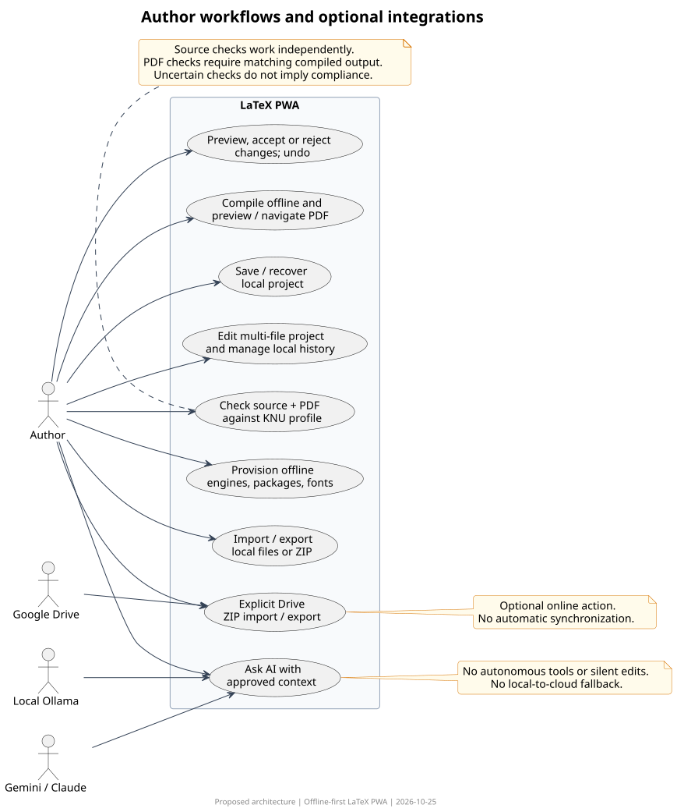

## Components and dependency direction

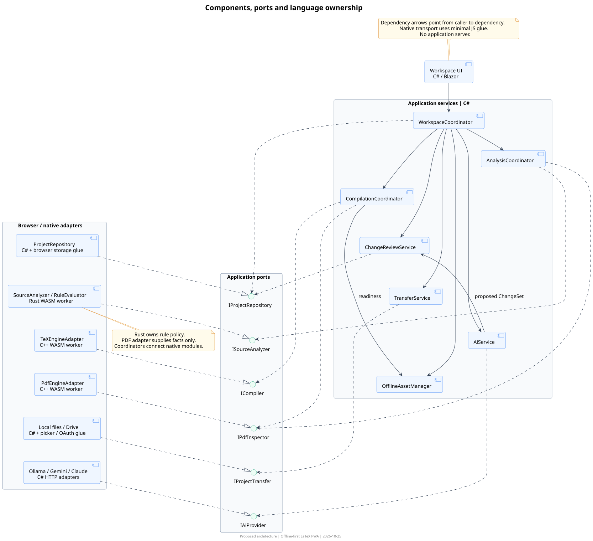

| Component | Owner | Responsibility and allowed dependencies |
|---|---|---|
| Workspace UI | C#/Blazor | Project tree, source editor, PDF surface, diagnostics, history, review and AI panels; calls application services |
| WorkspaceCoordinator | C# | Owns current immutable revision, dirty state and commands; schedules independent save and analysis/compile jobs |
| ProjectRepository | C# + browser glue | Recoverable local revision commits, checkpoints and artifact references; OPFS and IndexedDB only |
| AnalysisCoordinator | C# | Debounce, cancellation, freshness checks, profile selection and joined source/PDF reports |
| SourceAnalyzer / RuleEvaluator | Rust/WASM | Parse source, resolve project includes, evaluate rules over source facts and normalized PDF facts; propose deterministic patches |
| CompilationCoordinator | C# | Explicit/automatic compilation scheduling, engine capabilities, package availability and bounded passes |
| TeXEngineAdapter | C++/WASM integration | Virtual project filesystem, trusted engine calls, logs, PDF and source-map artifacts; no provider credentials |
| PdfEngineAdapter | C++/WASM integration | Page rendering, text/glyph geometry, font metadata and evidence extraction; no rule policy |
| ChangeReviewService | C# | Shared deterministic/AI patch validation, preview, acceptance, commit and undo |
| TransferService | C# | Explicit local/Drive import/export through adapters; independent of autosave |
| AiService | C# | User-approved context, provider routing, streamed chat and proposed edits; no autonomous tools |
| OfflineAssetManager | C# + service-worker glue | Provisioned asset inventories, checksums, compatibility and update readiness |

Application services depend on the ports in [contracts](contracts.md), never
provider implementations. Rust has no dependency on Blazor, Drive or AI. C++ PDF
inspection returns facts to Rust; it must not embed KNU thresholds. Rust does not
call C++ directly: the coordinator connects typed results. Native modules retain
independent build/test boundaries and separate WASM memories.

Handwritten JavaScript is limited to unavailable .NET browser bindings: worker
creation/message transport, OPFS/IndexedDB and picker calls, service-worker
lifecycle, Google browser authorization/Picker, and drawing a native raster when
needed. Keep credential/provider logic and HTTP requests in C#; generated
Emscripten/wasm-bindgen loaders are tool output. Browser glue never evaluates
rules or applies patches. Existing `wwwroot/js` bridges are migration seams, not
the final protocol. C/C++/Rust third-party engine dependencies require a recorded
license and feasibility decision; ownership does not imply rewriting TeX.

## Runtime and deployment

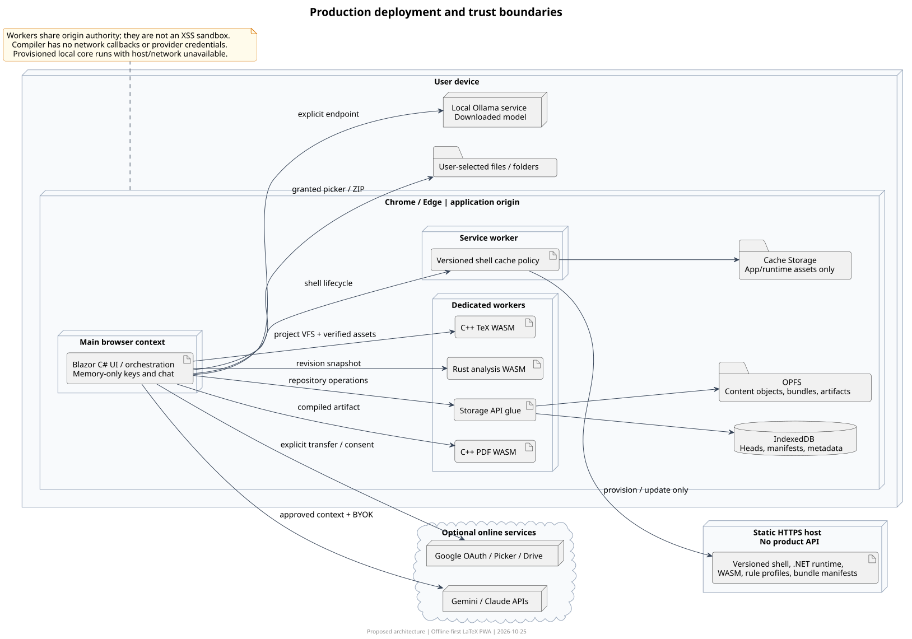

The production host serves immutable, versioned assets over HTTPS with SPA routing,
correct WASM MIME types and appropriate security headers. The current ASP.NET
host remains a development/static host; `/api/health` is not a product dependency.
After provisioning, the application must cold-start with that host unavailable.

Use one Rust analysis worker, one TeX worker and one PDF worker initially; storage
glue uses a dedicated worker for synchronous OPFS access. Workers need no pthreads
or shared memory. Explicitly assess COOP/COEP and OAuth compatibility before any
future dependency requires cross-origin isolation. Do not make it a hidden default.
Compilation and rendering cannot share a busy worker. Workers take immutable
snapshots or transferable buffers, expose cancellation and have operation budgets.
For a blocking native call, cancellation/timeouts terminate and recreate the worker;
merely cancelling a UI await is insufficient. Limit pending jobs and raster sizes.

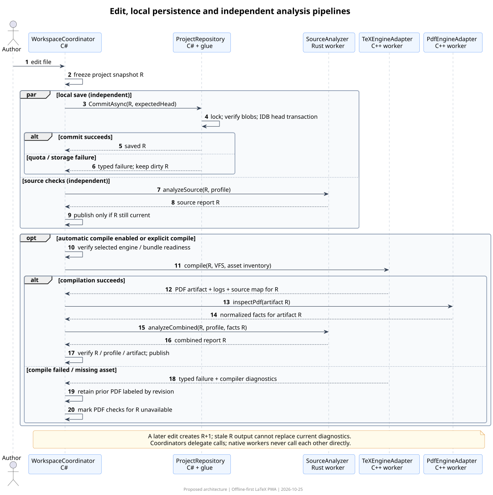

Edits immediately create revision R in memory. Save and source analysis are
independent jobs against R; compilation is separately scheduled when enabled or
explicitly requested. A failed save remains visibly dirty while analysis continues.
Compiler warnings/errors remain separate from profile diagnostics. A failed compile
retains the last PDF with its revision shown; PDF-derived checks for R are marked
unavailable, never passed. Successful compilation feeds PDF facts back to Rust for
combined checks. Source navigation uses SyncTeX/equivalent only when available;
otherwise show a page location without inventing a source span.

## Local persistence and recovery

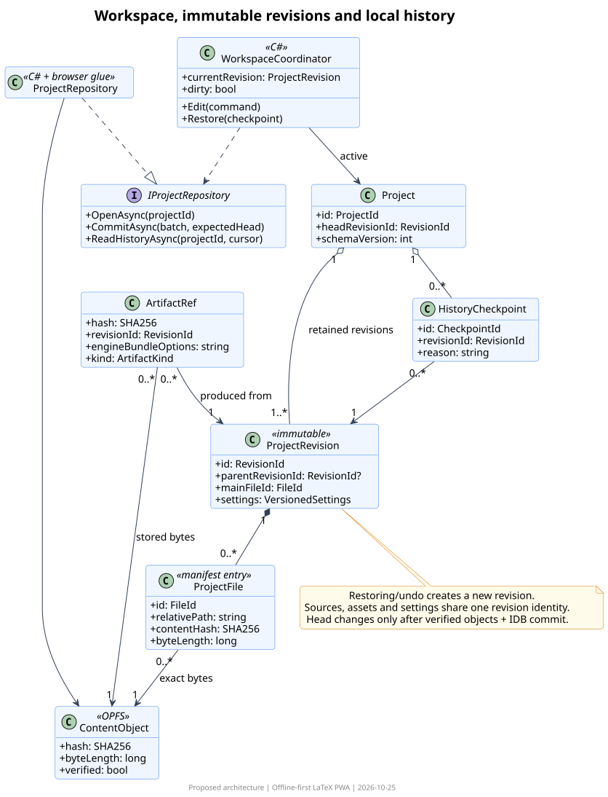

Local autosave is authoritative for the app's saved indicator. A linked directory
or Drive export is a separate user action with a separate status. Browser storage
is not a backup; offer ZIP export and request persistent storage, while handling
denial without losing the editing session. Do not claim a browser flush guarantees
survival of device failure.

Use OPFS immutable content objects keyed by SHA-256 and IndexedDB project heads,
revision manifests, history pointers, asset inventory and transfer metadata. Files
have stable IDs independent of normalized relative paths. Preserve text/newlines
unless explicitly edited; decode unsupported encodings through an explicit import
choice. Persist source revisions independently from regenerable PDFs/raster caches.

There is no atomic transaction spanning OPFS and IndexedDB. A commit is:

1. Hold an exclusive per-project Web Lock; compare the expected head revision.
2. Write new immutable content objects and close/flush their writers. Verify lengths
   and hashes before publishing a revision manifest.
3. In one IndexedDB transaction, store pending ancestor manifests plus the new
   manifest/checkpoint and replace the
   project head only if it still matches the expected parent.
4. Acknowledge saved only after transaction completion. Failed transactions leave
   unreachable objects, not an advanced head. Preserve in-memory edits for retry.

On open, validate the head's object references; fall back to the newest complete
checkpoint if damaged and explain the recovery. Never automatically delete a
damaged revision. Interrupted pre-head writes can be garbage collected later under
the project lock, after verifying they are not referenced by any retained revision.
Use a single writer per project: a second tab opens read-only, with an explicit
takeover after the prior writer releases the lock. Unsupported locking is a
capability error for writable projects, not permission to race.

Undo applies inverse edits as a new revision; restoring history also creates a new
revision. Neither rewinds identifiers nor erases the prior history. Checkpoint at
explicit save, accepted change set, import/restore and project close; coalesce
ordinary autosave history to avoid an unbounded checkpoint per keystroke.
Autosave commits are serialized. Coalescing may skip publishing intermediate heads,
but a commit batch includes every unpersisted ancestor manifest/content dependency
of its selected head. A failed earlier save must not leave a dangling parent in a
later successful commit. Retention/compaction is explicit follow-up work, not silent
ancestor deletion.

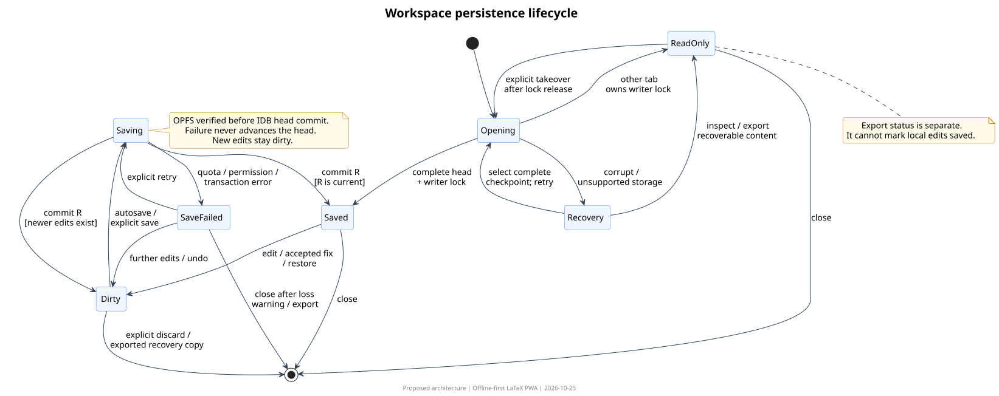

## Offline assets and upgrades

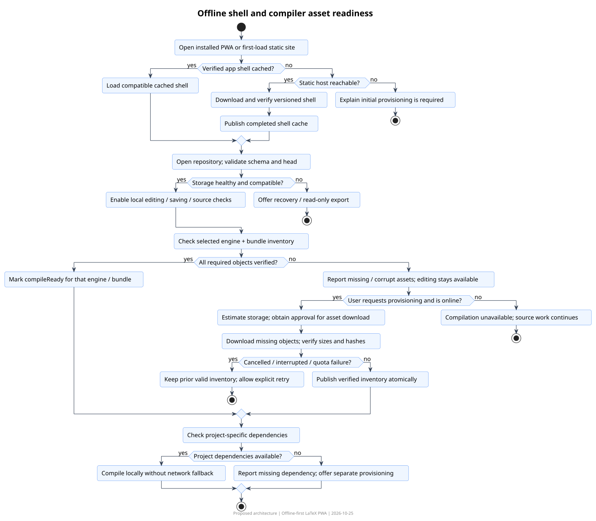

Cache Storage holds the versioned app shell/runtime/WASM. OPFS holds provisioned
TeX package/font bundles referenced by an inventory manifest with digests, licenses,
sizes and engine/bundle versions. IndexedDB records verified completion. Keep
credentials, provider requests and user documents out of service-worker caches.

Separate `appReady` from `compileReady(engine, bundle)` and project dependency
readiness. Provisioning is an explicit online action with quota estimates, progress,
cancellation and retry of missing/corrupt objects. Compilation itself has no network
fallback: report missing packages and offer provisioning outside the worker.
Do not equate one successful compile with broad offline readiness.

An update stages and verifies the new shell before activation. Ask the user to
reload after pending saves finish; never silently reload an editing session. Keep
the old asset set while controlled clients still use it. Version storage schemas,
use additive migrations first and keep a recoverable pre-migration manifest.
A migration failure opens recovery/read-only mode. Old clients must refuse writes
to a newer unsupported schema. No automatic destructive rollback of documents.

## Analyzer and reviewed changes

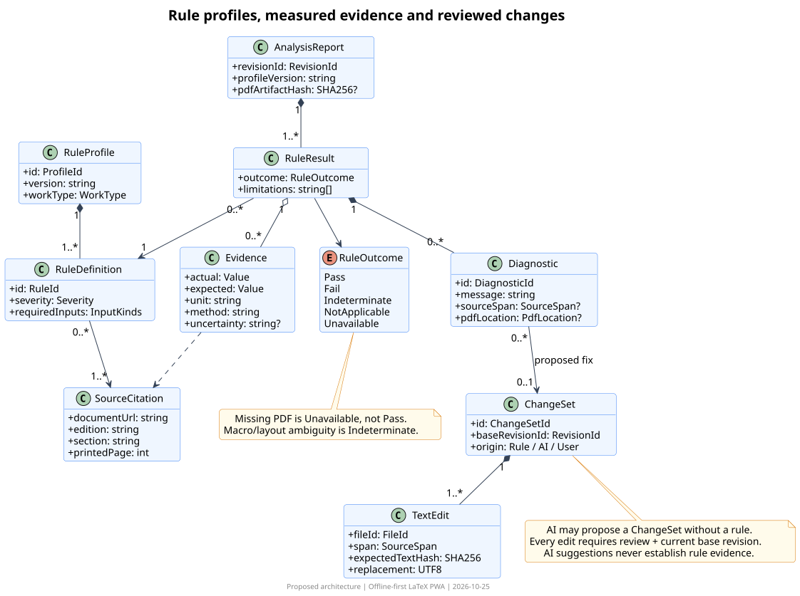

Profiles identify institution, faculty, guideline edition and work type. A rule
has provenance, applicability, evidence requirements and a result of pass, fail,
indeterminate, not applicable or unavailable. Reports retain coverage, not just
findings: a missing PDF must not produce an empty report interpreted as success.
Distinguish exact measurements from heuristic classification of headings or body
text. Dynamic macros, scanned PDFs and ambiguous layout require explicit uncertainty.

[Decisions](decisions.md#knu-profile-evidence) gives source-cited KNU examples.
The first profile checks a diploma project's source plus its compiled PDF; arbitrary
standalone PDF import/analysis is not required by this architecture.

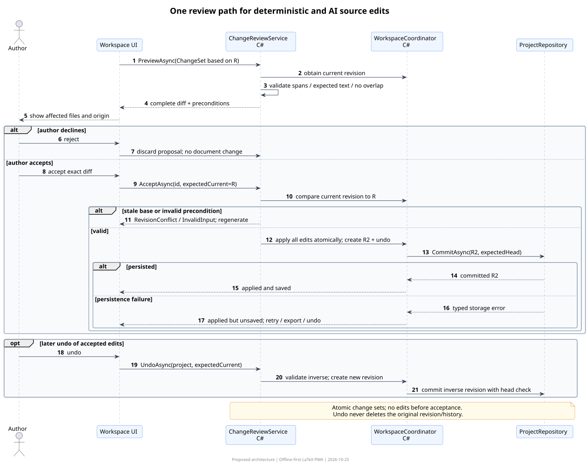

All deterministic and AI edits use the same ChangeReviewService. Review shows the
complete diff and affected files, then validates acceptance against the exact base
revision and expected text. Apply a change set atomically to a new in-memory revision
and commit it; if persistence fails, retain a visibly unsaved revision with undo.
Do not apply a subset silently. Read-only inputs, path escapes, stale bases and
overlaps are rejected. Deterministic fixes must be idempotent; AI edits have no
such correctness guarantee and cannot be promoted into rule evidence.

## Transfers and AI

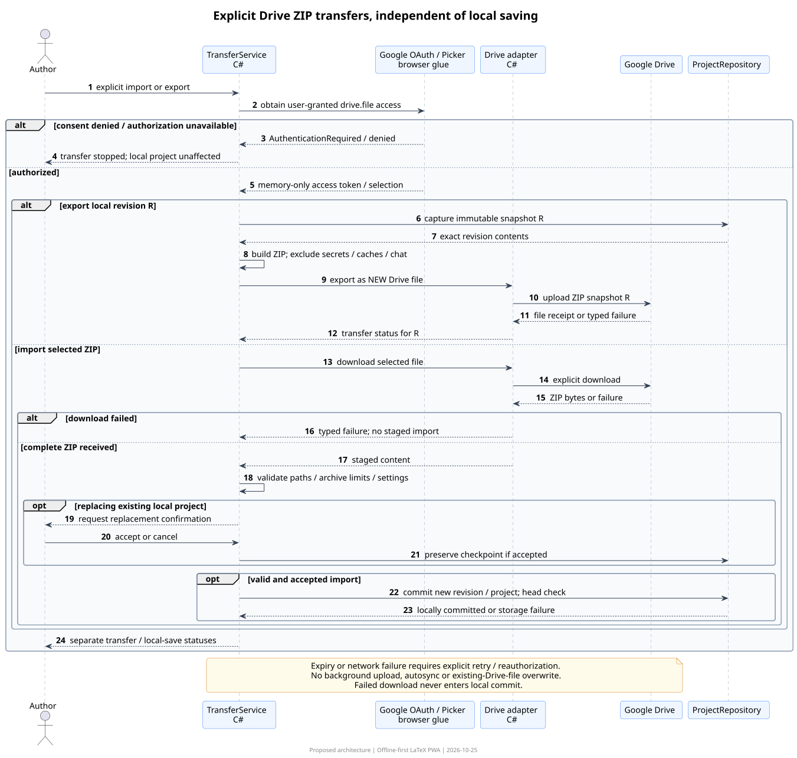

ZIP is the portable project interchange format: sources, assets and optional project
settings, never keys/tokens/chat history or generated caches. Apply archive entry,
size and expansion limits; reject absolute paths, traversal, symlinks and duplicate
normalized names. Prefer new-project import. Replacing an existing project requires
confirmation, a checkpoint and head-revision validation; persist locally before
showing import complete. Direct filesystem directory access is an optional Chromium
adapter, with file/ZIP upload-download as the portable fallback. Its write failures
do not change the local saved indicator.

Drive uses browser OAuth, Google Picker and `drive.file` scoped access. Export a
ZIP snapshot as a new Drive file by default. POC exports do not update an existing
Drive file, avoiding silent concurrent overwrites. Imports download a selected ZIP
then enter the same validation/review path as local import. Token expiry prompts
explicit reauthorization; network failure offers manual retry, no background queue.
Google scripts load only when the user opens the integration. No client secret.

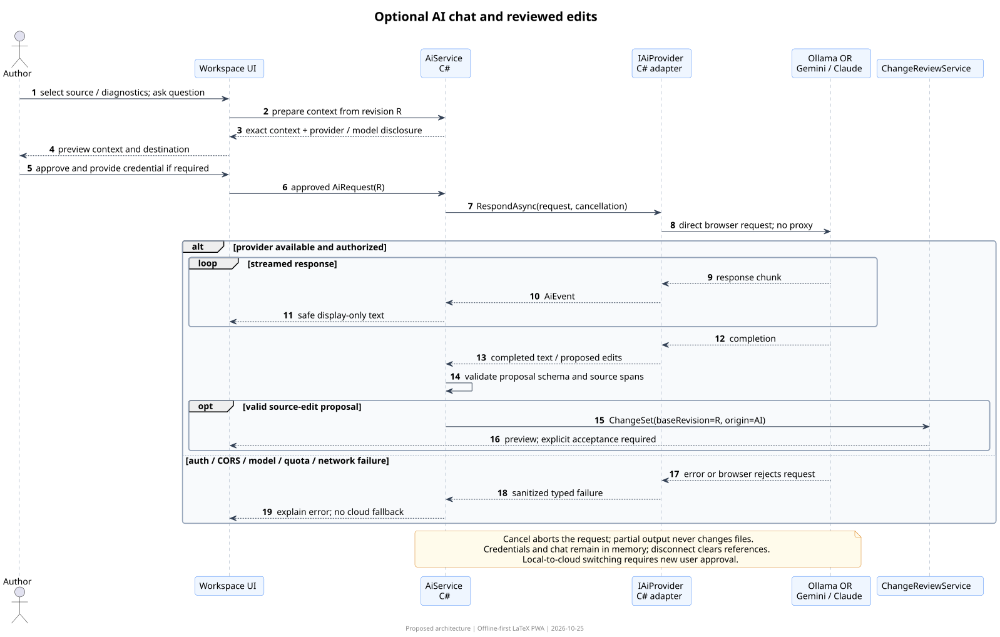

AI chat operates on explicitly selected source/diagnostics with a context preview,
provider, model and connectivity/cost disclosure. No automatic full-project upload.
C# adapters call Ollama, Gemini or Claude directly through browser networking;
direct-origin authentication/CORS/provider support is a feasibility gate. No proxy
backend or silent cloud fallback. Partial streamed output is display-only until a
complete validated change proposal is available. Chat and credentials are memory
only by default; reconnect requires user-provided credentials again. Model output
cannot invoke tools or alter file permissions. Cancellation stops the request and
never applies partial edits; a provider may already have processed/billed it.

## Security boundaries and operational limits

Documents and PDFs are untrusted data, but downloaded application code and engine
binaries are trusted executable dependencies. Disable TeX shell escape, expose only
the project VFS and provisioned read-only assets, and omit engine network/host-file
callbacks. Disable PDF actions/embedded scripting; render native pixels/text rather
than executable document HTML. Do not execute model-generated code or render raw
AI HTML. Enforce worker termination, page/raster/memory and archive limits.

Workers separate scheduling/memory, not origin authority: same-origin code can
access browser storage. Content Security Policy, reviewed dependencies and absence
of arbitrary script execution are essential; no document claims that WASM or a
worker protects keys from an XSS compromise. Use restrictive `script-src` with the
tested WASM allowance, `object-src 'none'`, no inline eval, explicit provider
`connect-src` destinations and a separate worker policy denying network where
feasible. Test Google OAuth/Picker requirements before publishing exact headers.
Custom Ollama endpoints are user-entered and disclosed; validate scheme/origin,
test local network permissions/CORS, and never request browser security bypasses.

Memory-only keys reduce persistence, not same-origin exposure. Clear credentials
on disconnect; redact errors/logs and exclude secrets from history, exports and
caches. Browser GC prevents a guarantee of immediate secure memory erasure.
Remote prompt retention remains governed by the selected provider. Diagnostics
for the app stay local and omit document content/secrets; no telemetry backend.

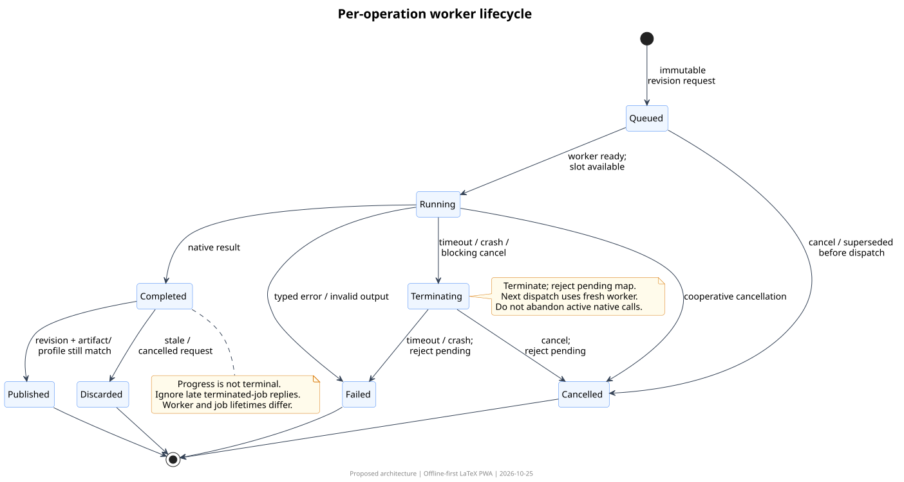

Physical download sizes and operation budgets remain benchmark outputs of the
feasibility gates, not invented performance promises. Budgets must be configurable
by operation and tested before enabling broad engine/package support.
